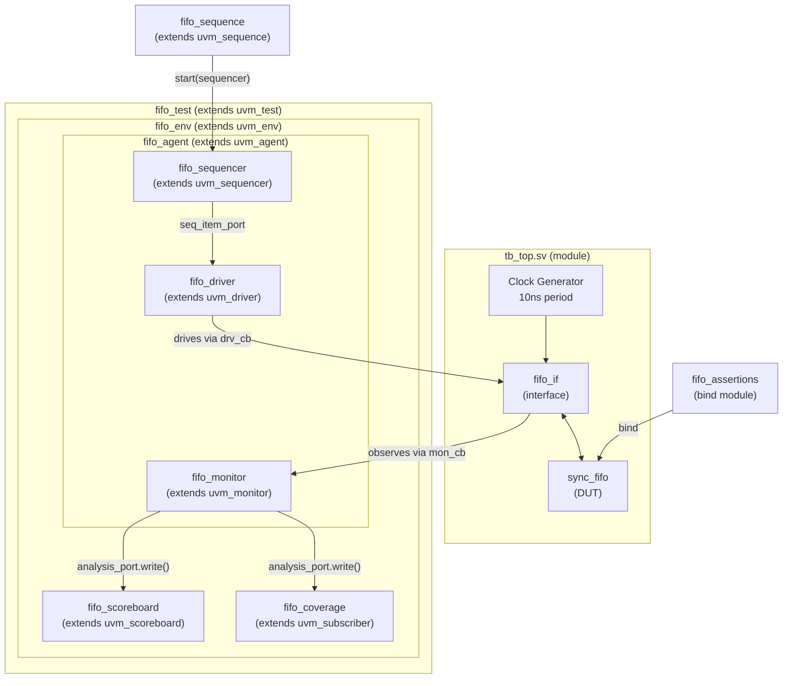

# Synchronous FIFO: Verification Plan and Test Plan (UVM)

| Field | Value |
|-------|-------|
| **Design Name** | `sync_fifo` |
| **Author** | Vũ Minh Quân |
| **Date Created** | 2026-09-17 |
| **Last Updated** | 2026-11-25 |
| **Version** | 1.2 |
| **Status** | Executed (v1). Open items listed in [Section 9](#9-execution-status-and-results) |
| **Tools** | Questa 2021.2, UVM 1.1d |
| **Methodology** | UVM (Universal Verification Methodology) |
| **Language** | SystemVerilog (IEEE 1800-2017) |

> **Reading guide:** Sections 1–8 are the plan as written before implementation. Where the implementation differs, the plan is annotated in place. [Section 9](#9-execution-status-and-results) records what was actually run, the results, and what is still open. Full report: [FIFO_Verification_Report.pdf](report/FIFO_Verification_Report.pdf).

| Version | Date | Change |
|---|---|---|
| 1.0 | 2026-09-17 | Initial plan |
| 1.1 | 2026-11-06 | Plan aligned with implementation; status columns, results and open items added |
| 1.1.1 | 2026-11-16 | Paths changed to the repository layout (§3.3, §3.4); O7 scoreboard part done; O8, O9 added |
| 1.2 | 2026-11-25 | Scoreboard replaced by the PR #1 reference model (own occupancy; data, flag and hold checks; reset). Regression and bug injection re-run (§9). O8 closed; O1 flag part closed |

---

## 1. DUT Overview

### 1.1 Description

The DUT is a **synchronous FIFO** (First-In-First-Out) buffer operating in a single clock domain. It stores up to 32 words of 8-bit data using a register-file memory array. Full/empty status is tracked via a **counter-based** approach (as opposed to the extra-pointer-bit method). The FIFO is used to decouple producer/consumer timing — a producer writes data in bursts, the consumer reads at its own pace, and the FIFO absorbs the difference.

### 1.2 Block Diagram

```
                    ┌──────────────────────────────────┐
                    │          sync_fifo                │
     clk ──────────▶│                                  │
     rst_n ─────────▶│  ┌────────────────────────────┐ │
                    │  │  mem[0:31]  (8-bit × 32)    │ │
     wr_en ─────────▶│  │                            │ │
     data_in[7:0] ──▶│  │   wr_ptr ──▶ [write side]  │──▶ full
                    │  │                            │ │
     rd_en ─────────▶│  │   rd_ptr ──▶ [read side]   │──▶ empty
                    │  │                            │──▶ data_out[7:0]
                    │  │   count ──▶ [status logic]  │ │
                    │  └────────────────────────────┘ │
                    └──────────────────────────────────┘
```

### 1.3 Port List

| Port | Direction | Width | Description |
|------|-----------|-------|-------------|
| `clk` | input | 1 | System clock (100 MHz, 10ns period) |
| `rst_n` | input | 1 | Active-low synchronous reset |
| `wr_en` | input | 1 | Write enable — stores `data_in` when `!full` |
| `rd_en` | input | 1 | Read enable — outputs next word when `!empty` |
| `data_in` | input | 8 | Write data |
| `data_out` | output | 8 | Read data (**registered** — updates 1 cycle after `rd_en`) |
| `full` | output | 1 | High when `count == DEPTH` (**combinational**) |
| `empty` | output | 1 | High when `count == 0` (**combinational**) |

### 1.4 Parameters

| Parameter | Type | Default | Description |
|-----------|------|---------|-------------|
| `DATA_WIDTH` | int | 8 | Bit-width of each FIFO word |
| `DEPTH` | int | 32 | Number of entries in the FIFO |

### 1.5 Internal Signals (from RTL analysis)

| Signal | Width | Description |
|--------|-------|-------------|
| `mem[0:DEPTH-1]` | DATA_WIDTH × DEPTH | Register-file memory array |
| `wr_ptr` | `$clog2(DEPTH)` = 5 bits | Write pointer (wraps at DEPTH-1 → 0 via natural overflow) |
| `rd_ptr` | `$clog2(DEPTH)` = 5 bits | Read pointer (same wrap behavior) |
| `count` | `$clog2(DEPTH)+1` = 6 bits | Occupancy counter (0 to DEPTH) |

### 1.6 Design Decisions & Verification Implications

| # | Design Decision | RTL Evidence | Verification Implication |
|---|----------------|-------------|--------------------------|
| D1 | **Synchronous reset** (not async) | `always_ff @(posedge clk) if (!rst_n)` | Reset only takes effect at next `posedge clk`. Driver must hold `rst_n=0` for multiple cycles. |
| D2 | **Writes gated by `!full`** | `wr_en && !full` (write block) | Overflow is silently ignored — no error flag. Must verify data isn't corrupted. |
| D3 | **Reads gated by `!empty`** | `rd_en && !empty` (read block) | Underflow is silently ignored. `data_out` holds its last value. |
| D4 | **`data_out` is registered** | Inside `always_ff`, updates on `posedge clk` | Output appears **1 cycle after** `rd_en`. Monitor must sample `data_out` with this latency. |
| D5 | **`full`/`empty` are combinational** | `assign full = (count == DEPTH)` | Flags update **same cycle** as count changes. No 1-cycle delay on flags. |
| D6 | **Simultaneous R/W: count unchanged** | `2'b11: count <= count` (counter case) | When both R+W valid: one word in, one word out, net zero change. |
| D7 | **Counter-based full/empty** | `count` register, not extra pointer bit | Simpler to verify — count is directly observable. |
| D8 | **Pointer wrap via natural overflow** | `wr_ptr` is 5 bits, wraps 31→0 automatically | Works because DEPTH=32 is a power of 2. **Would break for non-power-of-2 depths.** |
| D9 | **Memory not cleared on reset** | Only pointers and count reset, not `mem[]` | Old data remains in memory after reset, but is inaccessible (pointers reset). Not a bug, but worth knowing. |

---

## 2. Feature Extraction Matrix

| ID | Feature | Description | Verified By | Priority |
|----|---------|-------------|-------------|----------|
| F01 | Reset behavior | `rst_n=0`: `wr_ptr=0`, `rd_ptr=0`, `count=0`, `data_out=0`, `empty=1`, `full=0` | T01, A01 | P0 |
| F02 | Single write | `wr_en=1 && !full` stores `data_in` at `mem[wr_ptr]`, increments `wr_ptr` | T02, T09 | P0 |
| F03 | Single read | `rd_en=1 && !empty` outputs `mem[rd_ptr]` to `data_out` (next cycle), increments `rd_ptr` | T02, T09 | P0 |
| F04 | Full flag assertion | `full` goes high when `count` reaches `DEPTH` (32) | T03, A02, cp_full | P0 |
| F05 | Empty flag assertion | `empty` goes high when `count` reaches 0 | T04, A03, cp_empty | P0 |
| F06 | Overflow protection | Write when `full=1` is silently ignored: no corruption of stored data or pointers | T06, A04 | P0 |
| F07 | Underflow protection | Read when `empty=1` is silently ignored: `data_out` holds last value | T07, A05 | P0 |
| F08 | FIFO ordering (FIFO property) | Data read out in exact same order as written in | T08, scoreboard | P0 |
| F09 | Simultaneous R/W | `wr_en=1 && rd_en=1` when neither full nor empty: both execute, count unchanged | T05, cx_wr_rd, A10 | P1 |
| F10 | Pointer wrap-around | `wr_ptr`/`rd_ptr` correctly wrap from 31→0 after sustained operation | T10, scoreboard | P1 |
| F11 | Full/empty mutual exclusion | `full` and `empty` are never both 1 simultaneously | A07 | P0 |
| F12 | Stress robustness | No failures under 1000+ random constrained transactions | T09, coverage | P2 |
| F13 | Count arithmetic | `count` +1 on write only, −1 on read only, unchanged on simultaneous R/W, never > DEPTH | A06, A08, A09, A10 | P0 |

> F13 was added during implementation, when assertions A08–A10 were written. The final status of each feature is in [Section 9.2](#92-feature-status).

---

## 3. Verification Architecture (UVM)

### 3.1 UVM Testbench Block Diagram



### 3.2 Component Responsibilities

| Component | File | UVM Base Class | Responsibility |
|-----------|------|----------------|----------------|
| Interface | `fifo_if.sv` | *(not a class)* | Bundles signals, clocking blocks (`drv_cb`, `mon_cb`), modports |
| Sequence Item | `fifo_seq_item.sv` | `uvm_sequence_item` | One atomic transaction: `rand` fields (`wr_en`, `rd_en`, `data_in`) + DUT outputs (`data_out`, `full`, `empty`) |
| Sequence | `fifo_sequence.sv` | `uvm_sequence` | Generates N randomized seq_items, sends to sequencer via `start_item()`/`finish_item()` |
| Sequencer | `fifo_sequencer.sv` | `uvm_sequencer` | Arbitrates between sequences, passes items to driver (mostly boilerplate) |
| Driver | `fifo_driver.sv` | `uvm_driver` | Gets seq_items via `seq_item_port`, drives DUT pins through `drv_cb`, applies the initial reset |
| Monitor | `fifo_monitor.sv` | `uvm_monitor` | Passively samples all signals via `mon_cb`, broadcasts via `uvm_analysis_port` |
| Scoreboard | `fifo_scoreboard.sv` | `uvm_scoreboard` | Receives from monitor via `uvm_tlm_analysis_fifo` (`mon_fifo`). Reference queue `[$]` with its own occupancy (never uses the DUT's `full`/`empty`). Checks 1.1 read data (1-cycle latency), 1.2 `full`/`empty` against the model, 1.4 `data_out` holds when there is no read. Clears the model on `rst_n = 0` |
| Coverage | `fifo_coverage.sv` | `uvm_subscriber` | Receives from monitor, samples covergroup on every transaction |
| Agent | `fifo_agent.sv` | `uvm_agent` | Bundles sequencer + driver + monitor, supports `UVM_ACTIVE`/`UVM_PASSIVE` mode |
| Environment | `fifo_env.sv` | `uvm_env` | Instantiates agent + scoreboard + coverage, connects TLM ports |
| Test | `fifo_test.sv` | `uvm_test` | Creates environment, selects/starts sequence, configures parameters |
| Assertions | `fifo_assertions.sv` | *(module, not class)* | SVA concurrent properties, bound to DUT via `bind` |
| Package | `fifo_pkg.sv` | — | Bundles all class `include`s, `import uvm_pkg::*` |
| Top | `tb_top.sv` | *(module)* | Clock gen, DUT + interface instantiation, `config_db` set of the virtual interface, SVA `bind`, `run_test()` |

### 3.3 File Hierarchy (as implemented)

Paths are relative to the repository root (`rl-uvm-hw-trojan/`). The testbench was first developed in a standalone `00_uvm_fifo/{rtl,tb,scripts,doc}` tree; in this repository `tb/` is `uvm/fifo_uvm/` and the RTL is in the root `rtl/` folder.

```
rl-uvm-hw-trojan/
├── rtl/sync_fifo.sv              DUT with bug-injection switches (all off by default)
├── rtl/sync_fifo_clean.sv        same DUT without switches (used by the RL flow)
└── uvm/
    ├── fifo_uvm/                 testbench ("tb/")
    │   ├── fifo_if.sv            interface + clocking blocks
    │   ├── fifo_pkg.sv           package: includes all classes in dependency order
    │   ├── fifo_seq_item.sv      fifo_sequence.sv   fifo_sequencer.sv
    │   ├── fifo_driver.sv        fifo_monitor.sv    fifo_agent.sv
    │   ├── fifo_scoreboard.sv    fifo_coverage.sv   fifo_env.sv
    │   ├── fifo_test.sv          fifo_base_test + 4 tests
    │   ├── fifo_assertions.sv    SVA module (bound to DUT)
    │   ├── tb_top.sv             clock, DUT, interface, bind, run_test()
    │   ├── Makefile              questa_sim / result / gui / regress / bugs
    │   └── fifo_knobs.sv, fifo_knob_seq.sv, fifo_rl_observer.sv, rl_bandit.sv,
    │       rl_csv_logger.sv, fifo_rl_test.sv, fifo_top.sv   RL loop (not part of this plan)
    ├── scripts/                  run_one.sh, regress.sh, bugs.sh, gui.sh, build_report.py, crop_wave.py
    └── doc/                      this plan, report/, results/
```

### 3.4 Compile and Run

```bash
cd uvm/fifo_uvm
make questa_sim TESTNAME=fifo_test_random                 # one test (UVM 1.1d bundled with Questa)
make result TESTNAME=fifo_test_random SEED=3              # one test + full result set in out/runs/
make regress                                              # all tests x 5 seeds, merged coverage
make bugs                                                 # bug-injection campaign
```

Compile order used by the scripts: `fifo_if.sv` → `fifo_pkg.sv` → `sync_fifo.sv` (with `+cover`) → `fifo_assertions.sv` → `tb_top.sv`.

### 3.5 `fifo_pkg.sv` Include Order

```systemverilog
package fifo_pkg;
  import uvm_pkg::*;
  `include "uvm_macros.svh"

  `include "fifo_seq_item.sv"      // 1. transaction (no dependencies)
  `include "fifo_sequence.sv"      // 2. sequences (depends on seq_item)
  `include "fifo_sequencer.sv"     // 3. sequencer (depends on seq_item)
  `include "fifo_driver.sv"        // 4. driver (depends on seq_item)
  `include "fifo_monitor.sv"       // 5. monitor (depends on seq_item)
  `include "fifo_agent.sv"         // 6. agent (depends on drv + mon + seqr)
  `include "fifo_scoreboard.sv"    // 7. scoreboard (depends on seq_item)
  `include "fifo_coverage.sv"      // 8. coverage (depends on seq_item)
  `include "fifo_env.sv"           // 9. env (depends on agent + scb + cov)
  `include "fifo_test.sv"          // 10. test (depends on env + sequences)
endpackage
```

> In the repository, `fifo_pkg.sv` also includes the RL loop classes (`fifo_knobs`, `fifo_knob_seq`, `fifo_rl_observer`, `rl_bandit`, `rl_csv_logger`, `fifo_rl_test`) between these files. They do not change the four tests above.

---

## 4. Coverage Plan

### 4.1 Functional Coverage

| Covergroup | Coverpoint / Cross | Bins | Description | Target | Implemented | Result |
|------------|-------------------|------|-------------|--------|:---:|---|
| `fifo_cg` | `cp_wr_en` | `{0}`, `{1}` | Write enable toggle | 100% | Yes | 100% |
| | `cp_rd_en` | `{0}`, `{1}` | Read enable toggle | 100% | Yes | 100% |
| | `cx_wr_rd` | cross `cp_wr_en × cp_rd_en` | All 4 combos: (0,0) (0,1) (1,0) (1,1) | 100% | Yes | 100% |
| | `cp_full` | `{0}`, `{1}` | Full flag both states | 100% | Yes | 100% |
| | `cp_empty` | `{0}`, `{1}` | Empty flag both states | 100% | Yes | 100% |
| | `cx_wr_full` | cross `cp_wr_en × cp_full` | Catches write-when-full scenario | 100% | Yes | 100% |
| | `cx_rd_empty` | cross `cp_rd_en × cp_empty` | Catches read-when-empty scenario | 100% | Done | 100% (merged; 0 hits in some seeds) |
| | `cp_data_in` | `zero={0}`, `low={[1:127]}`, `high={[128:254]}`, `max={255}` | Data value distribution | 100% | Yes | 100% |
| | `cp_occupancy` | `empty_={0}`, `low_={[1:8]}`, `mid_={[9:16]}`, `high_={[17:24]}`, `near_full_={[25:31]}`, `full_={32}` | FIFO fill levels | >95% | No | Not implemented (open item O4) |

### 4.2 Transition Coverage (Advanced)

**Status: not implemented in v1** (open item O4). Full and empty rising edges are partly covered by cover properties `C01_FULL_REACHED` and `C02_EMPTY_REACHED` (both hit).

| Coverpoint | Transitions | Description |
|-----------|-------------|-------------|
| `cp_full_trans` | `0 => 1`, `1 => 0` | Full flag rising and falling edges |
| `cp_empty_trans` | `0 => 1`, `1 => 0` | Empty flag rising and falling edges |
| `cp_occupancy_trans` | `0 => 1` (first write), `31 => 32` (becomes full), `32 => 31` (leaves full), `1 => 0` (becomes empty) | Critical occupancy transitions |

### 4.3 Code Coverage Targets

| Metric | Target | Exclusions | Result (merged, 20 runs) |
|--------|--------|------------|---|
| Line coverage | >95% | None expected | 94.44% (17/18): the 1 miss is the unreachable `default:` statement (below target until waived) |
| Branch coverage | >95% | `default` case in count logic (unreachable: all 4 cases covered) | 92.30% (12/13): the 1 miss is that `default:` branch. Waiver not yet applied |
| Toggle coverage | >90% | Clock, reset | 98.68% (75/76): `rst_n` 1→0 never toggles (no mid-test reset) |
| Expression coverage | >90% | `wr_en && !full`, `rd_en && !empty`: all truth table rows | 100% (conditions 4/4, expressions 2/2) |

### 4.4 Coverage Closure Strategy

```
1. Run T09 (random_stress, 1000+ transactions) → generate initial coverage
2. Analyze coverage report:
   - `vcover report -details -annotate fifo_cov.ucdb`
3. Identify uncovered bins → map to directed tests:
   - cp_occupancy "full_" not hit? → run T03 (fill_to_full)
   - cx_wr_full (1,1) not hit? → run T06 (write_when_full)
4. Mark truly impossible bins as `ignore_bins` with justification
5. Re-run all tests → merge coverage → check ≥95%
```

---

## 5. Assertion Plan

The table shows the properties **as implemented** in `tb/fifo_assertions.sv`. The plan had 7 properties; A08–A10 were added during implementation, and A01/A04/A05 were refined (see Note).

| ID | Assertion label | SVA Description | Condition (as implemented) | Feature | Result (20 runs) |
|----|--------------|-----------------|-----------|---------|---|
| A01 | `A01_RESET_STATE` | After reset de-asserts, FIFO is in a clean state | `$rose(rst_n) \|-> (empty && !full)` | F01 | 0 failures |
| A02 | `A02_FULL_IFF_DEPTH` | Full high if and only if count equals DEPTH | `full == (count == DEPTH)` | F04 | 0 failures |
| A03 | `A03_EMPTY_IFF_ZERO` | Empty high if and only if count equals 0 | `empty == (count == 0)` | F05 | 0 failures |
| A04 | `A04_NO_WR_WHEN_FULL` | A write attempt while full does not move the write pointer | `(full && wr_en) \|=> $stable(wr_ptr)` | F06 | 0 failures |
| A05 | `A05_NO_RD_WHEN_EMPTY` | A read attempt while empty does not move the read pointer | `(empty && rd_en) \|=> $stable(rd_ptr)` | F07 | 0 failures |
| A06 | `A06_COUNT_BOUNDS` | Count never exceeds DEPTH | `count <= DEPTH` | F13 | 0 failures |
| A07 | `A07_FULL_EMPTY_MUTEX` | Full and empty never both high | `!(full && empty)` | F11 | 0 failures |
| A08 | `A08_COUNT_INC_ON_WRITE` | Valid write only → count +1 | `(wr_en && !full && !(rd_en && !empty)) \|=> count == $past(count)+1` | F13 | 0 failures |
| A09 | `A09_COUNT_DEC_ON_READ` | Valid read only → count −1 | `(rd_en && !empty && !(wr_en && !full)) \|=> count == $past(count)-1` | F13 | 0 failures |
| A10 | `A10_COUNT_STABLE_ON_RW` | Valid simultaneous R/W → count unchanged | `(wr_en && !full && rd_en && !empty) \|=> $stable(count)` | F09, F13 | 0 failures |

Cover properties: `C01_FULL_REACHED`, `C02_EMPTY_REACHED`, `C03_SIMULTANEOUS`, `C04_WR_WHEN_FULL`, `C05_RD_WHEN_EMPTY`. All 5 are hit in the merged regression.

> [!NOTE]
> - All properties except A01 use `disable iff (!rst_n)`.
> - **A01** checks in the same cycle (`|->`), because `full` and `empty` are combinational from `count`.
> - **A04/A05** check only when a write/read is actually attempted. The plan's form (`full |=> $stable(wr_ptr) || !full`) was weaker.
> - **A06** checks count bounds (F13). Pointer wrap (F10) is checked by the scoreboard, not by A06 as originally planned.
> - **Known gap (O2):** the action blocks use `$error`, which UVM does not count. The regression scripts therefore also fail a run on any simulator `** Error`.

### Bind Strategy

```systemverilog
// In fifo_assertions.sv — keeps assertions separate from RTL
module fifo_assertions #(parameter int DATA_WIDTH = 8, parameter int DEPTH = 32) (
  input logic clk, rst_n,
  input logic wr_en, rd_en,
  input logic [DATA_WIDTH-1:0] data_in, data_out,
  input logic full, empty,
  input logic [$clog2(DEPTH)-1:0] wr_ptr, rd_ptr,   // DUT internals, reachable through bind
  input logic [$clog2(DEPTH):0]   count
);
  // All properties and assertions defined here
endmodule

// In tb_top.sv: bind to DUT without modifying RTL
bind sync_fifo fifo_assertions #(.DATA_WIDTH(DATA_WIDTH), .DEPTH(DEPTH)) sva_inst (.*);
```

---

## 6. Test Plan

### 6.1 Test Summary

| ID | Test Name | Pri | Type | Lens | Features | Implemented as | Status |
|----|-----------|-----|------|------|----------|---|---|
| T01 | `test_reset` | P0 | Directed | Reset | F01 | `fifo_test_reset` | Done, 5/5 seeds PASS |
| T02 | `test_single_write_read` | P0 | Directed | Data | F02, F03, F08 | (not separate) | Indirect: covered by `fifo_test_fill_drain` |
| T03 | `test_fill_to_full` | P0 | Directed | Boundary | F02, F04 | `fifo_test_fill_drain` (fill phase) | Done, 5/5 PASS |
| T04 | `test_drain_to_empty` | P0 | Directed | Boundary | F03, F05 | `fifo_test_fill_drain` (drain phase) | Done, 5/5 PASS |
| T05 | `test_simultaneous_rw` | P1 | Directed | Adversarial | F09 | (not separate) | Indirect: covered by random only: `cx_wr_rd`, `C03`, A10 hit |
| T06 | `test_write_when_full` | P0 | Directed | Adversarial | F06 | `fifo_test_write_when_full` | Done, 5/5 PASS |
| T07 | `test_read_when_empty` | P0 | Directed | Adversarial | F07 | **missing** | Missing (open item O3) |
| T08 | `test_fifo_ordering` | P0 | Directed | Data | F08 | (not separate) | Indirect: covered by fill_drain (32 values in order) |
| T09 | `test_random_stress` | P2 | Random | All | F12, all | `fifo_test_random` (2,000 items) | Done, 5/5 PASS |
| T10 | `test_alternating_rw` | P1 | Directed | Temporal | F10 | (not separate) | Indirect: wrap reached in fill_drain and random; all pointer bits toggle 0↔1 |

Done: implemented and passing. Indirect: no separate test, covered by another test (evidence given). Missing: not covered.

### 6.2 Detailed Test Specifications

---

#### T01 — `test_reset`

| Field | Detail |
|-------|--------|
| **Priority** | P0 |
| **Type** | Directed |
| **Lens** | Reset & Recovery |
| **Features** | F01 |
| **Prerequisite** | None (first test to run) |
| **Stimulus** | 1. Assert `rst_n = 0` for 5 clock cycles. 2. Release `rst_n = 1`. 3. Hold `wr_en=0`, `rd_en=0` throughout. |
| **Expected Behavior** | After `rst_n` rises: `empty=1`, `full=0`, `data_out=0`. Internal: `wr_ptr=0`, `rd_ptr=0`, `count=0`. |
| **Pass Criteria** | All output signals match expected on the first cycle after reset de-assertion. |
| **UVM Implementation** | Sequence sends 5 items with `rst_n=0`, then releases. Driver handles reset via `vif.rst_n <= 0`. |
| **Coverage Bins Hit** | `cp_empty{1}`, `cp_full{0}`, `cp_occupancy{empty_}` |

---

#### T02 — `test_single_write_read`

| Field | Detail |
|-------|--------|
| **Priority** | P0 |
| **Type** | Directed |
| **Lens** | Data Integrity |
| **Features** | F02, F03, F08 |
| **Prerequisite** | T01 (reset) |
| **Stimulus** | 1. Reset. 2. Write 1 word (`data_in=0xAB, wr_en=1, rd_en=0`). 3. Wait 1 cycle. 4. Read 1 word (`wr_en=0, rd_en=1`). 5. Wait 1 cycle (registered output). |
| **Expected Behavior** | `data_out = 0xAB` one cycle after `rd_en`. `empty` goes `1→0` on write, back to `1` after read. |
| **Pass Criteria** | Scoreboard: `data_out === 0xAB`. Flags: `empty=1` before write, `empty=0` after write, `empty=1` after read. |
| **UVM Implementation** | Directed sequence with inline constraints: `item.randomize() with { wr_en==1; rd_en==0; data_in==8'hAB; };` then `item.randomize() with { wr_en==0; rd_en==1; };` |
| **Coverage Bins Hit** | `cp_wr{1}`, `cp_rd{1}`, `cp_data_in{high}`, `cp_empty{0,1}`, `cp_occupancy{empty_, low_}` |

---

#### T03 — `test_fill_to_full`

| Field | Detail |
|-------|--------|
| **Priority** | P0 |
| **Type** | Directed |
| **Lens** | Boundary |
| **Features** | F02, F04 |
| **Prerequisite** | T01 |
| **Stimulus** | 1. Reset. 2. Write 32 words sequentially (`data_in = 0,1,2,...,31`), `rd_en=0` throughout. |
| **Expected Behavior** | After 32nd write: `full=1`, `empty=0`, `count=32`. `full` was `0` for writes 1-31. |
| **Pass Criteria** | `full === 1` after DEPTH writes. `empty === 0` throughout. No assertion violations. |
| **UVM Implementation** | Sequence with `repeat(32)` loop, inline constraint: `{ wr_en==1; rd_en==0; }`. Use incrementing `data_in` for later ordering checks. |
| **Coverage Bins Hit** | `cp_full{0,1}`, `cp_full_trans{0=>1}`, `cp_occupancy{all bins from empty_ to full_}` |

---

#### T04 — `test_drain_to_empty`

| Field | Detail |
|-------|--------|
| **Priority** | P0 |
| **Type** | Directed |
| **Lens** | Boundary |
| **Features** | F03, F05 |
| **Prerequisite** | T03 (FIFO must be full) |
| **Stimulus** | 1. Start from full FIFO (run T03 first). 2. Read 32 words, `wr_en=0` throughout. |
| **Expected Behavior** | After 32nd read: `empty=1`, `full=0`, `count=0`. Data read back: `0,1,2,...,31` (FIFO ordering from T03). |
| **Pass Criteria** | `empty === 1` after DEPTH reads. Scoreboard: all 32 data values match in order. |
| **UVM Implementation** | Chain sequence: `fifo_seq_fill` followed by `fifo_seq_drain`. Or single sequence with two phases. |
| **Coverage Bins Hit** | `cp_empty{0,1}`, `cp_empty_trans{0=>1}`, `cp_full_trans{1=>0}`, `cp_occupancy{full_ down to empty_}` |

---

#### T05 — `test_simultaneous_rw`

| Field | Detail |
|-------|--------|
| **Priority** | P1 |
| **Type** | Directed |
| **Lens** | Adversarial |
| **Features** | F09 |
| **Prerequisite** | T01 |
| **Stimulus** | 1. Reset. 2. Write 16 words to half-fill. 3. Drive `wr_en=1, rd_en=1` for 10 consecutive cycles with new data. |
| **Expected Behavior** | Count stays at 16 during simultaneous R/W (per RTL counter case: `2'b11 → count unchanged`). Data integrity preserved: reads return previously written data in order, new writes stored correctly. |
| **Pass Criteria** | Scoreboard: 0 mismatches. Count stable at 16 during simultaneous R/W phase. |
| **UVM Implementation** | Sequence phase 1: fill with `{ wr_en==1; rd_en==0; }` ×16. Phase 2: `{ wr_en==1; rd_en==1; }` ×10. |
| **Coverage Bins Hit** | `cx_wr_rd{(1,1)}`, `cp_occupancy{mid_}` |

---

#### T06 — `test_write_when_full`

| Field | Detail |
|-------|--------|
| **Priority** | P0 |
| **Type** | Directed |
| **Lens** | Adversarial + Boundary |
| **Features** | F06 |
| **Prerequisite** | T01 |
| **Stimulus** | 1. Reset. 2. Fill FIFO completely (32 writes: values `0x00..0x1F`). 3. Attempt 3 more writes (`data_in = 0xFF`), `rd_en=0`. 4. Read all 32 entries back. |
| **Expected Behavior** | Extra writes silently ignored. `full` stays 1. On readback: values are `0x00..0x1F` — **no `0xFF` anywhere**. `wr_ptr` does not advance past write 32. |
| **Pass Criteria** | Scoreboard: all 32 reads match original data. `0xFF` does **not** appear in any read. |
| **UVM Implementation** | Sequence: fill phase (32 items), overflow phase (3 items with `data_in=0xFF`), drain phase (32 reads). |
| **Coverage Bins Hit** | `cx_wr_full{(1,1)}` — the key bin |

---

#### T07 — `test_read_when_empty`

| Field | Detail |
|-------|--------|
| **Priority** | P0 |
| **Type** | Directed |
| **Lens** | Adversarial + Boundary |
| **Features** | F07 |
| **Prerequisite** | T01 |
| **Stimulus** | 1. Reset. 2. Attempt 3 reads (`rd_en=1, wr_en=0`) from empty FIFO. 3. Check `data_out`, `empty`, `rd_ptr`. |
| **Expected Behavior** | `data_out` stays at 0 (reset value). `empty` stays 1. `rd_ptr` does not advance. |
| **Pass Criteria** | `empty === 1` throughout. `data_out === 0` (unchanged from reset). No assertion violations. |
| **UVM Implementation** | Sequence: 3 items with `{ wr_en==0; rd_en==1; }`. Monitor verifies no change. |
| **Coverage Bins Hit** | `cx_rd_empty{(1,1)}` — the key bin |

---

#### T08 — `test_fifo_ordering`

| Field | Detail |
|-------|--------|
| **Priority** | P0 |
| **Type** | Directed |
| **Lens** | Data Integrity |
| **Features** | F08 |
| **Prerequisite** | T01 |
| **Stimulus** | 1. Reset. 2. Write 4 known values: `0xAA, 0xBB, 0xCC, 0xDD`. 3. Read 4 values. |
| **Expected Behavior** | Read order: `0xAA, 0xBB, 0xCC, 0xDD` — **exact FIFO order**. |
| **Pass Criteria** | Scoreboard: all 4 reads match expected in sequence. Any out-of-order → **FAIL**. |
| **UVM Implementation** | Directed sequence with hardcoded `data_in` values. Scoreboard reference queue enforces ordering. |
| **Coverage Bins Hit** | `cp_data_in{high}`, `cp_occupancy{low_}` |

---

#### T09 — `test_random_stress`

| Field | Detail |
|-------|--------|
| **Priority** | P2 |
| **Type** | Constrained-Random |
| **Lens** | All (safety net) |
| **Features** | F12, all |
| **Prerequisite** | T01 |
| **Stimulus** | 1. Reset. 2. Run 2000 randomized transactions with default constraints: `wr_en dist {1:=60, 0:=40}`, `rd_en dist {1:=40, 0:=60}`. This biases toward filling. |
| **Expected Behavior** | Zero scoreboard mismatches. All assertions pass. Coverage targets hit. |
| **Pass Criteria** | `fail_count == 0`. Coverage > 95%. No `UVM_ERROR` or `UVM_FATAL`. |
| **UVM Implementation** | Default `fifo_sequence` with `num_transactions=2000`. Constraints in `fifo_seq_item`. Run: `vsim +UVM_TESTNAME=fifo_test_random`. |
| **Coverage Bins Hit** | Most or all bins — this is the primary coverage driver |

---

#### T10 — `test_alternating_rw`

| Field | Detail |
|-------|--------|
| **Priority** | P1 |
| **Type** | Directed |
| **Lens** | Temporal / Sequence |
| **Features** | F10 |
| **Prerequisite** | T01 |
| **Stimulus** | 1. Reset. 2. Repeat 96 times (DEPTH × 3): write 1 word (incrementing data), then read 1 word. |
| **Expected Behavior** | Every read returns the value just written. Pointers wrap from 31→0 three times without error. |
| **Pass Criteria** | Scoreboard: 96 reads, 0 mismatches. No assertion violations (especially A06 — pointer bounds). |
| **UVM Implementation** | Sequence with `repeat(96)` loop, alternating `{ wr_en==1; rd_en==0; }` then `{ wr_en==0; rd_en==1; }`. |
| **Coverage Bins Hit** | `cp_occupancy{empty_, low_}` (oscillates between 0 and 1), pointer wrap coverage |

---

### 6.3 Feature-to-Test Traceability Matrix (as planned)

> This is the matrix written before implementation. The as-executed matrix, with evidence, is in [Section 9.2](#92-feature-status).

> *Every feature must have ≥1 test. Every test must map to ≥1 feature.*

| | T01 | T02 | T03 | T04 | T05 | T06 | T07 | T08 | T09 | T10 |
|------|:---:|:---:|:---:|:---:|:---:|:---:|:---:|:---:|:---:|:---:|
| F01 | x | | | | | | | | | |
| F02 | | x | x | | | | | | x | |
| F03 | | x | | x | | | | | x | |
| F04 | | | x | | | | | | | |
| F05 | | | | x | | | | | | |
| F06 | | | | | | x | | | | |
| F07 | | | | | | | x | | | |
| F08 | | x | | | | | | x | | |
| F09 | | | | | x | | | | | |
| F10 | | | | | | | | | | x |
| F11 | | | | | | | | | | |
| F12 | | | | | | | | | x | |

> [!NOTE]
> **F11** (full/empty mutex) has no dedicated test — it's verified **continuously** by assertion A07 during every test. This is fine; not every feature needs a directed test if an assertion guards it 100% of the time.

---

## 7. Milestones & Schedule

| # | Milestone | Exit Criteria | Status |
|---|-----------|---------------|--------|
| M1 | RTL done | `sync_fifo.sv` compiles, smoke-tested | Done |
| M2 | Interface done | `fifo_if.sv` compiles, no warnings | Done |
| M3 | UVM skeleton runs | item + driver + monitor + `tb_top.sv` compile; reset test prints `UVM_INFO` | Done |
| M4 | Scoreboard integrated | Random test runs end-to-end; scoreboard reports pass/fail | Done |
| M5 | All directed tests pass | T01–T08, T10 all PASS | Partial: implemented directed tests pass; T07 missing (O3) |
| M6 | Coverage targets met | Functional >95%, code >90% | Done: functional 100%, toggle 98.7%, line/branch 94.4/92.3% until `default:` waiver (O5) |
| M7 | Assertions clean | All SVA properties active, zero violations in passing tests | Done: 10/10 active, 0 failures in 20 runs |
| M8 | Sign-off | README written, Makefile works, can explain every line | Partial: Makefile/regression done; README and open items pending |

---

## 8. Risks & Mitigations

| # | Risk | Impact | Likelihood | Mitigation | Outcome |
|---|------|--------|------------|------------|---|
| R1 | `data_out` timing mismatch: monitor samples same cycle as `rd_en`, but output is registered (1-cycle delay) | Scoreboard false failures on every read | High (very common) | Let the scoreboard account for the latency | Handled: scoreboard sets `expect_read` and checks `data_out` on the next item |
| R2 | Pointer wrap only works for power-of-2 DEPTH | Tests pass at DEPTH=32 but design breaks at DEPTH=20 | Medium | Add parameterized test with non-power-of-2 DEPTH | Open: only DEPTH=32 simulated (O6) |
| R3 | UVM `config_db` / virtual interface wiring errors | Simulation crashes before any test runs | High (first time) | Bring up `tb_top` → `fifo_if` → DUT first, then add classes | Resolved |
| R4 | Random constraints don't hit corner cases (full, empty) | Low coverage on `cx_wr_full`, `cx_rd_empty` | Medium | Directed tests T06, T07 | Occurred: T07 not written; read-when-empty reached only in some seeds (C05 = 0 hits with seed 1). See O3 |
| R5 | Simultaneous R/W scoreboard logic mismatches RTL | Wrong order for same-cycle R+W | Medium | Process write before read in scoreboard | Handled: reads and writes are accepted from the model's own occupancy; the read pops before the write pushes. Confirmed by `BUG_COUNT_RW` detection |

---

## 9. Execution Status and Results

Regression run on 2026-11-05 with Questa 2021.2. **Re-run on 2026-11-25 with the v1.2 scoreboard** (Questa 2021.2_1): regression summary identical (same PASS table, reads checked and coverage); flag and hold checks give 0 false failures on the clean RTL; bug-injection table updated below. Evidence files are in [`results/`](results/). The report in [`report/`](report/) still describes the v1.1 scoreboard.

### 9.1 Regression

| Test | Seeds | PASS | Reads checked (seed 1) |
|---|---:|---:|---:|
| `fifo_test_reset` | 5 | 5 | 0 |
| `fifo_test_fill_drain` | 5 | 5 | 32 |
| `fifo_test_write_when_full` | 5 | 5 | 32 |
| `fifo_test_random` | 5 | 5 | 853 |
| **Total** | **20** | **20** | 4,556 reads over all runs, **0 mismatches** |

A run passes only if `UVM_ERROR = 0`, `UVM_FATAL = 0`, there is no simulator `** Error` (SVA), and the scoreboard prints PASS. Coverage merged over 20 runs: functional **100%** (24/24 bins), assertions 10/10, total **98.17%**. Details: [`results/regression_summary.txt`](results/regression_summary.txt).

### 9.2 Feature Status

| ID | Feature | Evidence (as executed) | Status |
|---|---|---|---|
| F01 | Reset behavior | `fifo_test_reset`; A01 (0 failures) | Done |
| F02 | Single write | fill_drain, random; scoreboard; A08 | Done |
| F03 | Single read | fill_drain, random; scoreboard (1-cycle latency); A09 | Done |
| F04 | Full flag | fill_drain, write_when_full; A02; `cp_full`; `C01` | Done |
| F05 | Empty flag | fill_drain; A03; `cp_empty`; `C02` | Done |
| F06 | Overflow protection | `fifo_test_write_when_full`; A04; `cx_wr_full`; `C04` | Done |
| F07 | Underflow protection | A05 and `cx_rd_empty` hit **only in random, some seeds**; no directed test | Partial (O3) |
| F08 | FIFO ordering | fill_drain (0…31 read back in order); scoreboard queue model | Done |
| F09 | Simultaneous R/W | random; `cx_wr_rd`; `C03`; A10 | Done (no directed T05) |
| F10 | Pointer wrap-around | fill_drain/random wrap 31→0; all pointer bits toggle both ways; scoreboard | Done (no directed T10) |
| F11 | Full/empty mutex | A07 in every run | Done |
| F12 | Stress robustness | 2,000-item random × 5 seeds, 0 mismatches | Done |
| F13 | Count arithmetic | A06, A08, A09, A10 in every run | Done |
| — | Reset during traffic | Not tested: `rst_n` never falls after the initial reset | Missing (O7) |

### 9.3 Bug Injection (environment validation)

Five RTL bugs were compiled in one at a time (`+define+BUG_<NAME>`), each run with all 4 tests × 5 seeds. Full table: [`results/bug_report.txt`](results/bug_report.txt).

| Bug | Detected by | Checks that fired |
|---|---|---|
| `BUG_FULL_EARLY` | fill_drain, write_when_full, random (5/5 seeds each) | A02 + scoreboard flag + data (v1.1: A02 only, scoreboard only in random) |
| `BUG_WRITE_WHEN_FULL` | write_when_full, random (5/5) | A04 + scoreboard data |
| `BUG_READ_WHEN_EMPTY` | **random only, 3/5 seeds** | A05 + scoreboard data + hold |
| `BUG_COUNT_RW` | random (5/5) | A10 + scoreboard data + flag + hold |
| `BUG_DATA_BITFLIP` | fill_drain, write_when_full, random (5/5) | scoreboard data only |

**5/5 detected**, with the same tests, seeds and first-error times as the v1.1 run (2026-11-05). The SVA catches control bugs first; with v1.2 the scoreboard also catches every bug on its own, and it is still the only check that catches data corruption.

### 9.4 Open Items

| ID | Item | Found by | Action |
|---|---|---|---|
| O1 | Scoreboard passes while data is lost: with `BUG_FULL_EARLY` + fill_drain it reports 0 mismatches and 1 unread item; only A02 fails (ISSUE-009) | Bug injection | Compare `full`/`empty` against the model; check leftover items at end of test. **2026-11-25:** flag check done (v1.2 scoreboard; `BUG_FULL_EARLY` now fails the scoreboard in every test that fills the FIFO). Still open: leftover items in the model at end of test are reported but do not fail the run |
| O2 | SVA failures use `$error`, so UVM does not count them | Bug injection | Report through `` `uvm_error ``; until then, scripts also check `** Error` |
| O3 | No directed read-when-empty test (T07) | Bug injection, R4 | Add `fifo_test_read_when_empty` |
| O4 | `cp_occupancy` and transition coverage (Section 4.1–4.2) not implemented | Plan review | Implement, or remove from plan with justification |
| O5 | Unreachable `default:` counted as a line/branch miss | Coverage review | Apply a coverage exclusion with a written justification |
| O6 | Only DEPTH = 32 simulated (R2) | Plan review | Run a second configuration, or document as out of scope |
| O7 | No reset during traffic; scoreboard does not clear its model on reset | Toggle coverage | Add a mid-test reset test and reset handling in the scoreboard. **2026-11-16:** scoreboard now clears its model on `rst_n=0` (exercised by the RL reset arms); directed mid-test reset test still missing |
| O8 | Scoreboard gates reads on the DUT's sampled `empty`, not on its own occupancy, so a corrupted `empty` steers the model (lab notebook ISSUE-010) | Study review 2026-11-16 | Gate reads with `ref_count != 0`; check `full`/`empty` against the model (together with O1). **Done 2026-11-25** (v1.2 scoreboard) |
| O9 | A02–A06 and A08–A10 read DUT internals (`count`, `wr_ptr`, `rd_ptr`): white-box checks, not interface checks (ISSUE-011) | Study review 2026-11-16 | Label them white-box; add interface-only versions for black-box use |
